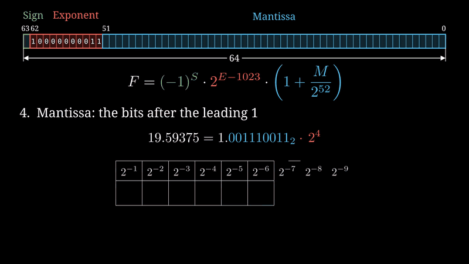

# IEEE 754 Double Precision — Manim Animations

Educational animations showing how a decimal number becomes an IEEE 754 binary64 value and why decimal fractions incur rounding error.

[Русская версия](README.ru.md) · [Wiki sources](docs/wiki/Home.md) · [GitHub Wiki](https://github.com/SYRRUS-Ali/ieee754-manim/wiki)



## Contents

- [Videos](#videos)
- [Installation](#installation)
- [Rendering](#rendering)
- [Project structure](#project-structure)
- [Mathematical background](#mathematical-background)
- [Configuration and limitations](#configuration-and-limitations)
- [Troubleshooting](#troubleshooting)
- [Contributing](#contributing)
- [Authors and license](#authors-and-license)

## Videos

| Scene | What it explains | Existing English video | Russian class |
| --- | --- | --- | --- |
| `BuildDouble` | `19.59375`: binary conversion, normalization, biased exponent, fraction, sign and reconstruction | [Watch / download](videos/BuildDouble.mp4) | `BuildDoubleRU` |
| `RoundoffError` | `0.3`: recurring binary digits, rounding and signed/relative error | [Watch / download](videos/RoundoffError.mp4) | `RoundoffErrorRU` |

Russian on-screen translations are provided in `ieee754_scenes_ru.py`. Russian MP4 files are not included yet: render and visually review them below. The scenes do not add narration or audio. GitHub may offer downloads instead of inline MP4 playback.

Sign bits are green, exponent bits red, stored fraction bits light blue, and the discarded tail yellow. Results are computed using Python `struct` and exact rational arithmetic with `Fraction`.

## Installation

The repository pins **Manim Community 0.22.0**. Use a compatible Python release; Python 3.12 is a practical starting environment, not a declared minimum. These scenes use `MathTex`, so install LaTeX with `dvisvgm`. On Windows, MiKTeX is an option. Russian captions use DejaVu Sans; bit digits use DejaVu Sans Mono. Install these fonts or choose verified alternatives.

From PowerShell in the repository root:

```powershell
python -m venv .venv
.\.venv\Scripts\python.exe -m pip install --upgrade pip
.\.venv\Scripts\python.exe -m pip install -r requirements.txt
.\.venv\Scripts\python.exe -m manim checkhealth
```

Direct interpreter calls avoid PowerShell activation-policy issues. The first `python` must be a real installation, not the Microsoft Store alias. Otherwise, use the full path to your installed interpreter.

See the [official installation guide](https://docs.manim.community/en/stable/installation/uv.html) for platform-specific native dependencies. If compilation requests Microsoft Visual C++, install the corresponding Build Tools workload described there.

## Rendering

Run from the repository root. Low-quality previews (480p, 15 fps):

```powershell
.\.venv\Scripts\python.exe -m manim -pql ieee754_scenes.py BuildDouble RoundoffError
.\.venv\Scripts\python.exe -m manim -pql ieee754_scenes_ru.py BuildDoubleRU RoundoffErrorRU
```

Final-quality renders (1080p, 60 fps):

```powershell
.\.venv\Scripts\python.exe -m manim -qh ieee754_scenes.py BuildDouble RoundoffError
.\.venv\Scripts\python.exe -m manim -qh ieee754_scenes_ru.py BuildDoubleRU RoundoffErrorRU
```

Default Russian output paths:

```text
media/videos/ieee754_scenes_ru/1080p60/BuildDoubleRU.mp4
media/videos/ieee754_scenes_ru/1080p60/RoundoffErrorRU.mp4
```

After reviewing the full videos for clipping, missing glyphs, overlap and mathematical consistency:

```powershell
New-Item -ItemType Directory -Force -Path videos/ru
Copy-Item -LiteralPath media/videos/ieee754_scenes_ru/1080p60/BuildDoubleRU.mp4 -Destination videos/ru/BuildDoubleRU.mp4
Copy-Item -LiteralPath media/videos/ieee754_scenes_ru/1080p60/RoundoffErrorRU.mp4 -Destination videos/ru/RoundoffErrorRU.mp4
```

`media/` is ignored by Git; `videos/` holds selected deliverables. Custom Manim settings may change output paths. Add Russian video links only after the files exist.

## Project structure

```text
ieee754-manim/
├── ieee754_scenes.py       # English scenes and drawing helpers
├── ieee754_scenes_ru.py    # Russian on-screen edition
├── ieee754_utils.py        # Bit conversion and exact arithmetic
├── requirements.txt       # manim==0.22.0
├── assets/preview.gif
├── videos/
│   ├── BuildDouble.mp4
│   └── RoundoffError.mp4
├── docs/wiki/              # Prepared Russian Wiki pages
├── README.md
├── README.ru.md
└── LICENSE
```

Helpers include `double_bits`, `bits_to_double`, `split_fields`, `decode_fields`, `binary_expansion`, `normalize`, `times_two_steps`, `round_mantissa` and decimal/LaTeX formatting. `decode_fields` handles normal finite values only.

## Mathematical background

Binary64 has one sign bit, 11 exponent bits and 52 explicitly stored fraction bits. For a normal finite number:

$$x=(-1)^S\,2^{E-1023}\left(1+\frac{M}{2^{52}}\right),\quad 1\le E\le2046.$$

The implicit leading `1` gives 53 significant binary digits. The captions call the stored fraction field the mantissa; the full significand includes the implicit leading bit.

```text
19.59375 = 10011.10011₂ = 1.001110011₂ × 2⁴
S = 0
E = 4 + 1023 = 1027 = 10000000011₂
M = 001110011 followed by 43 zeros
Hex = 0x4033980000000000
```

For `0.3`, the exact input is `3/10`, with binary expansion `0.01001100110011…₂`:

```text
Stored value: 0.299999999999999988897769753748434595763683319091796875
Hex: 0x3FD3333333333333
Signed error (stored − input): approximately −1.1102230246251565 × 10⁻¹⁷
Relative error |stored − input| / |input|: approximately 3.7007434154171883 × 10⁻¹⁷
```

Machine epsilon (the spacing above `1.0`) is `ε = 2⁻⁵²`; unit roundoff for round-to-nearest is `u = 2⁻⁵³`. The usual relative-error bound concerns rounding within the normal range, not subnormals, underflow or overflow.

## Configuration and limitations

Both scene files define:

```python
SCENE1_NUMBER = "19.59375"
SCENE2_NUMBER = "0.3"
SCENE2_FRAC_BITS = 90
```

Strings preserve the intended decimal input when passed to `Fraction`. These are worked-example animations, not a general converter for every binary64 value:

- The shipped examples are the intended baseline. The Russian source duplicates the scene structure; keep algorithm changes synchronized between languages.
- `BuildDouble` uses at most eight initial fractional bits and displays at most twelve mantissa bits before describing the remaining digits as zero. Arbitrary inputs can make that explanation incorrect.
- `RoundoffError` assumes a positive recurring decimal fraction with enough generated bits for a guard bit; its infinite-expansion captions do not suit terminating fractions.
- General zero, negative, subnormal, NaN, infinity, overflow and underflow inputs are unsupported by the scenes.
- `round_mantissa` returns the increment decision, not a final carry-normalized significand/exponent. `normalize` expects at least one `1`.
- Long values and captions can require layout adjustments.

Russian source has syntax and localization checks, but still requires rendering and visual review before publication.

## Troubleshooting

| Symptom | Check |
| --- | --- |
| `No module named manim` | Install and render with the same `.venv` interpreter. |
| `latex` / `dvisvgm` missing | Check LaTeX installation and PATH; reopen the terminal. |
| Missing `.cls` / `.sty` | Install the packages requested by the LaTeX log. |
| Russian letters appear as boxes | Install DejaVu Sans or configure a verified Cyrillic font. |
| Overlap or clipping | Shorten/reposition captions and repeat the preview. |
| No files in `videos/` | Find renders under `media/` and copy selected final videos manually. |

## Contributing

Explain the issue, include a reproducible command, and attach a preview for animation changes. Check numerical changes against exact `Fraction` values and `struct` binary64 output. Automated numerical tests and CI are proposed improvements, not existing features.

Start with [Wiki sources](docs/wiki/Home.md). The Wiki covers theory, scenes, helpers, rendering, localization and improvements. Publication is separate: see [Wiki publishing](docs/WIKI-PUBLISHING.md).

## Authors and license

Ali Makhmud and Mohamad Mehrez — group 231-352, as credited in the original scene.

[MIT License](LICENSE). Third-party tools and dependencies retain their own licenses.

## References

- [Manim documentation](https://docs.manim.community/en/stable/)
- [Python floating-point arithmetic](https://docs.python.org/3/tutorial/floatingpoint.html)
- [Python fractions](https://docs.python.org/3/library/fractions.html)
- [Python struct](https://docs.python.org/3/library/struct.html)